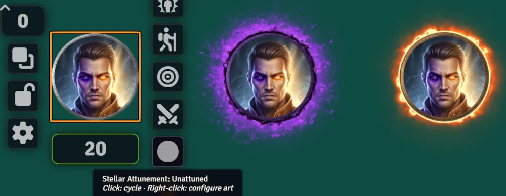

# Outrider's Stellar Attunement

<div align="center">

[](https://github.com/0utrider/pathfinder)
[](https://foundryvtt.com/packages/outrider-stellar-attunement)

</div>

SF2e Solarian helper. Cycles Stellar Attunement and keeps token art in sync.

<p align="center"></p>

## Cycle

| Current | Click → |
|---|---|
| Unattuned | Graviton |
| Graviton / Photon (1st click) | the opposite attunement |
| Graviton / Photon (2nd click) | Unattuned |

Changing attunement from the character sheet (Actions › Encounter) or PF2e HUD also swaps the art, and resets the swap tracking.

## Art convention

Default art (unattuned) = the prototype token image. Graviton = `<base>-1.<ext>`, Photon = `<base>-2.<ext>`.
e.g. `tokens/solarian.webp` → `solarian-1.webp` / `solarian-2.webp`.
Override per actor: right-click the Token HUD button, or `api.configure(actor)`. A field left blank uses the default for that state, and blanking a field you had filled removes that override.

The module writes each state's art to the prototype token, so new tokens come out right. It keeps a note of the original image on the actor, so Unattuned goes back to it even when only the attuned states have overrides. If you change the prototype token image yourself, that becomes the new original.

A world that used overrides on 1.0.x may already have lost the original (1.0.x kept no note). Set the prototype token image once, or fill in the Unattuned override, and it is remembered from then on.

## Macro

```js
game.modules.get("outrider-stellar-attunement").api.cycle();          // controlled token / assigned character
game.modules.get("outrider-stellar-attunement").api.cycle("Actor Name");                // by name, id or uuid
game.modules.get("outrider-stellar-attunement").api.setAttunement(null, "photon");
```

## Macros

On install and on every update, the module copies its macros from the compendium into the world, in the **Macros** sidebar under **Outrider's Mods > Stellar Attunement**. They default to Observer, so players can see and run them without a GM having to share them by hand. The compendium itself, **Macros** (`outrider-stellar-attunement.outrider-stellar-attunement-macros`), lives directly in the brand-violet **Outrider's Mods** compendium folder, alongside the rest of the Outrider family's packs.

| Macro | Does |
|---|---|
| Graviton Attunement | Set Graviton |
| Photon Attunement | Set Photon |
| Unattuned | Set Unattuned |
| Cycle Attunement | Run the cycle above |

Each acts on the controlled token, or your assigned character. If a GM changes a macro's ownership or moves it, that choice is kept on later syncs. Pack source lives in `src/packs/`, and `packs/` is built with `@foundryvtt/foundryvtt-cli` `compilePack`.

## JB2A token borders

With Sequencer + JB2A active, a persistent border marks the attunement:

- Graviton → `jb2a.token_border.circle.static.purple.006`
- Photon → `jb2a.token_border.circle.static.orange.008`
- Unattuned → border removed

Borders draw behind the token by default and are scaled so the JB2A dark ring just peeks out from behind the token frame. Changing any border setting replays the borders live.

Switching removes this module's border first. It also removes any other JB2A token border, e.g. one from Automated Animations; you can turn that off in settings. Borders are Sequencer persistent effects on each token. When a scene loads or a token is placed, the active GM's client (or the owning player's, if no GM is online) re-checks the borders, once Sequencer has put its own persistent effects back.

### During the token's turn

Foundry v13+ draws the combat turn marker on the interface layer, above all token art, so it covers a behind-the-token border. The **Border during the token's turn** setting chooses what to do while it's that token's turn:

- **Expand** (default): grow the border to wrap just outside the turn marker (scale × the marker's size ratio, 1.5 by default), then shrink it back when the turn passes.
- **Above**: draw the border over the marker. This also draws it over the portrait.
- **Off**: leave it as is.

## Dynamic Token Ring

Off by default. With **Color the token ring** on, a token that has Foundry's Dynamic Token Ring enabled takes a ring color and a background color for its attunement:

- Graviton → ring `#8a5cff`
- Photon → ring `#ff9d00`
- Unattuned → the colors of the actor's prototype token

The background colors are blank by default, which keeps the token's own background. The colors travel in the same token update as the art swap, and follow **Update tokens in all scenes**. A token placed while its actor is attuned starts with the state's colors.

Only a ring that is already on is colored: the module does not turn rings on, because that changes how the token art is framed. The prototype token's ring colors are never written, so turning the option off puts every token back to them. Ring, art swap and JB2A border work together on one token.

If the ring has its own subject texture (Appearance tab, Ring Subject), Foundry draws that image and the art swap does not show on that token.

## Combat end

When the GM ends an encounter, every attuned Solarian in it drops to Unattuned (art and border included). Turn this off with **Unattune when the encounter ends**.

## Attack animations

Solarian strikes are synthetic weapons, so Automated Animations can't attach to them. Instead, when an attack-roll card for **Solar Weapon** or **Solar Flare** is posted, the rolling client plays a ranged Sequencer effect from the Solarian to the target. The attunement comes from the roll's own options, so the animation reflects the attunement at the moment of the roll. Misses animate as misses. Twin Weapons strikes use the Solar Weapon animations.

| Attack | Graviton | Photon |
|---|---|---|
| Solar Weapon | `jb2a.energy_strands.range.multiple.dark_purple.01` | `jb2a.scorching_ray.02.orange` |
| Solar Flare | `jb2a.fireball.beam.dark_purple` | `jb2a.fireball.beam.orange` |

These match the Automated Animations menu picks (AA "Energy Strand 02" is JB2A's `multiple` strand). The target is the one recorded on the roll, falling back to the roller's current target.

## Settings

The module has one entry in **Configure Settings**: the **Configure Settings** button under its name opens a single window, one box per area. World settings are for the GM. The two marked with a person icon are saved per browser, and they are the only ones a player sees.

**Attunement**

- **Update tokens in all scenes** (world, default on)
- **Token HUD button** (per browser, default on)
- **Show notification** (per browser, default off)

**Token borders**

- **JB2A token borders** (world, default on)
- **Draw borders behind the token** (world, default on)
- **Border during the token's turn** - expand / above / off (world, default expand)
- **Clear other JB2A token borders** (world, default on)
- **Graviton** and **Photon**: **Border** (Sequencer database path) and **Scale** (`scaleToObject`, default 2.05)

**Dynamic Token Ring**

- **Color the token ring** (world, default off)
- **Graviton** and **Photon**: **Ring color** and **Background color**

**Attack animations**

- **JB2A attack animations** (world, default on)
- **Solar Weapon** and **Solar Flare**: one Sequencer database path each for Graviton and Photon

**Encounter end**

- **Unattune when the encounter ends** (world, default on)

Setting keys are the same as in 1.0.x, so a world keeps its values.

### Picking an animation

With Sequencer and JB2A active, each border and attack field has two buttons beside it. Without them the fields are plain text.

- **Browse** opens a picker: one drop-down per part of the database path, a looping clip of the entry, and the path itself. Border fields list token borders, attack fields list ranged entries (the ones Sequencer can stretch to a target), with the energy and beam groups first. **Show the whole database** lifts the filter. **Use this animation** puts the path in the field. Nothing is stored until you save the settings window.
- **Play** shows the animation on the canvas, for you alone and without storing anything: a border on your selected token (else the first Solarian on the scene) at the scale and layer in the form, an attack from that token to your target, or six squares to the right with no target.
